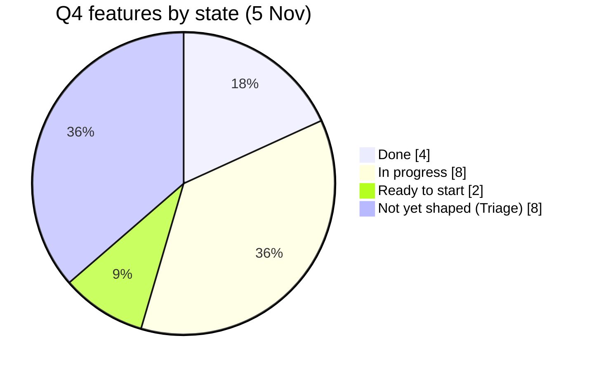
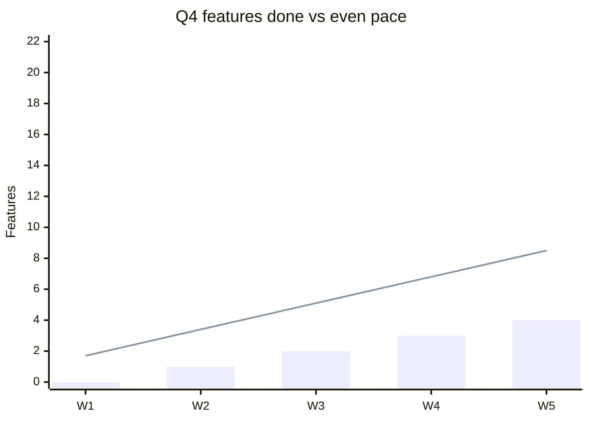

# Progress reports

Periodic team status or retro for a week, month or quarter. Readers: developers, team lead, product owner. Each should learn within a minute whether the team is on track, what landed, what is stuck and what they need to do. Evidence rules from the [evidence contract](evidence-contract.md) (lines 1–36) still apply; supplied figures only.

## Contents

- [Precedence over agent-content](#precedence-over-agent-content)
- [Names before numbers](#names-before-numbers)
- [Say each fact once](#say-each-fact-once)
- [Section guidance](#section-guidance)
- [Voice](#voice)
- [Worked example](#worked-example)
- [Visuals](#visuals)
- [Length](#length)

## Precedence over agent-content

This template's sections win over these general `fusion-agent-content` rules:

- **One ask for one group:** a progress report serves all three readers in the visible part. Give each decision in **Needs attention** to the role that owns it (team lead, product owner, developers). Do not move other roles' asks into per-ask folds.
- **Aggregate table:** use the **Closed as done** bullets, not a table.
- **One screen:** use the length per period below instead.
- **Evidence IDs beside visuals** ([evidence contract](evidence-contract.md#reader-useful-visuals)): the readback names its source in plain words ("Source: GitHub issue search, 5 November"), not as an "(E1)" code; the method fold holds the full collection note.
- **Audience-alignment output:** use it to review the draft, but never paste reader cards or review findings into the report, folds included.

The only folds are the two in the template plus **References and evidence**.

## Names before numbers

- First mention of any issue, PR or epic: readable title, then reference, for example `Fusion Foundry Agents (equinor/fusion-core-tasks#2332)`. Later mentions may use a short name.
- Readable title: drop area tags (`[Governance]`), commit prefixes (`feat(aks):`), emoji and scope tags such as "Enterprise-wide:". Shorten long titles, but keep their meaning. The reference keeps the exact title one click away.
- Never list bare numbers ("#2227, #2228, #2229"). Name every item readers must act on in visible text. Fold names only for items that need no action.
- Ratios in words: "none of its 5 sub-issues closed", "3 of 5 sub-issues closed". Do not write "0/5" or "3/5". Show a percentage only next to its count.
- Translate board and label jargon on first use: "still waiting to be shaped (Triage)". Drop raw label names such as `Objective:Quality&Governance` from visible text unless readers must apply them.

## Say each fact once

- TL;DR gives the headline and the one ask. **Where we stand** explains it. Retro and follow-ups refer back without repeating counts.
- At most one visible table. The metrics scorecard goes in the **The numbers behind this report** fold.
- No colour or emoji status codes (🔴 🟡 ⚠️). Write "main risk" or "on track" in words.
- One visible caveat at most (`progress.limits`), and only one that changes how to read the report. Sampling notes, data sources and previous reports go in **How this report was made**.
- No disclaimers about what a figure is not ("this is not a forecast"). Put the real limit in `progress.limits` once.
- When sources disagree (snapshot versus live lookup), use the newer figure in visible text and note the difference in **How this report was made**.
- Say "sub-issues", not "children".
- Folds hold support, not prose: a metrics table and a short method list.

## Section guidance

- **TL;DR**: one sentence with the verdict, then one quoted line for each role with its single most important action this period: `> - **Team lead:** …`, `> - **Product owner:** …`, `> - **Developers:** …`.
- **Where we stand**: two or three short paragraphs. First compare pace with elapsed time, and say in the same sentence that it is a warning by feature count, not a forecast ("4 of 22 features done with 39 % of the quarter gone. Counted by features, not size, that is a warning sign"). Then say what drives the gap, and what it means for the plan. No bullets.
- **Closed as done**: up to six items. Tag each with where it belongs, *Q4 plan*, *Q3 carry-over* or *outside the plan*, so the headline count and this list add up. Each says what the work is meant to give users or the team, in words a product owner understands ("app admins can see which apps are unhealthy"), not how it was built. Claim that something is live or verified only when release or acceptance evidence is supplied.
- **Objectives**: when objectives are supplied, end **Where we stand** with one plain sentence per objective: progressing, at risk, or can't tell yet, and why.
- **Needs attention**: up to five items, ordered by risk with the biggest first. Each gets a bold name line, then:
  - why it matters now, with the deadline or date when one is supplied; if the deadline is unknown, say so ("the support deadline is not recorded");
  - what happens if nobody decides ("slips to Q1", "blocks the Foundry release");
  - the recorded assignee (`@handle`) or "unassigned";
  - one role that decides, naming who prepares if anyone ("Team lead prepares options; product owner decides").
  For the biggest decision of the period, give two or three options, mark one as recommended, and say what each one gives up. When candidate scope is not recorded, say so instead of inventing options. When an entry covers several items readers must act on, list them as short sub-bullets so each one can be picked up. Name features that are ready to start, so developers can pick them up.
  Each decision appears here only. The TL;DR role lines point to it in a few words; follow-ups don't repeat it.
- **Retro**: prose, two to four sentences for each of keep and change. Describe team patterns; no per-person counts or names in visible text.
- **Dates**: use only dates recorded in the evidence, such as a milestone due date, a project target date or a deadline in an issue body. Never propose decision or due dates. When a date matters but isn't recorded, say "no date recorded" in visible text, and make setting it a follow-up.
- **Follow-ups**: GitHub task list, up to eight, ordered by risk. Each risk in **Needs attention** gets at least one follow-up before any housekeeping. Group similar tasks, such as breaking down several features, into one follow-up with sub-bullets naming each item. These are tasks, not decisions. Each `title` is an imperative task title that one person could take as an issue ("Break down Subsea catalogue PC3 into sub-issues"). Split catch-all tasks. `context` follows on the next line: `Parent: <owner/repo#123> · Owner: <recorded @handle, or "proposed: <role> (unassigned)"> · due <recorded date, or omit>. Done when <visible end state>.` Use real assignees only when the evidence supplies them; never invent names. Follow-ups are proposals, not decisions.

## Voice

Write as a teammate talking to the team, not an auditor filing findings.

- Use "we" for the team. Use active verbs: "we closed 485 issues", not "485 issues were closed".
- Give a plain verdict before the explanation: "That gap alone is not alarming." "What is alarming is where the effort goes."
- Name concrete things, not abstract nouns. Write "small tasks that agents can pick up", not "clearly bounded tasks". Avoid words like reconcile, disposition, traceable, commitments, alignment and ensure.
- Keep to one idea per sentence and about 25 words at most. Don't chain clauses with semicolons.
- In "done when" lines, describe something a reader can see: "the epic lists what will ship in Q4", not "justified decisions are recorded".

## Worked example

Match this voice and density. The facts are illustrative.

```markdown
> **TL;DR:** We are closing plenty of issues, but only 4 of 22 Q4 features are done, and the Foundry Agents epic has not closed any of its parts.
> - **Team lead:** prepare Foundry Agents scope options for the product owner.
> - **Product owner:** decide which unshaped features stay in Q4.
> - **Developers:** break down the features you pick up into sub-issues this week.

## Where we stand

We are 36 days into the 92-day quarter (39 %), and 4 of the 22 Q4 features are done (18 %). That is behind a straight-line pace, though infrastructure work tends to finish late, so the gap alone is not alarming.

What is alarming is where the effort goes. We closed 485 issues since 1 October, against 65 in the same weeks of Q3, but only about one in five is a feature or user story. The work is real; it is just not moving the planned features.

## Needs attention

**Fusion Foundry Agents (equinor/fusion-core-tasks#2332)**
This is the quarter's flagship epic, and none of its 5 sub-issues have closed. Three of its features are still waiting to be shaped. If nothing changes, the agents slip to Q1. Unassigned; no decision date recorded. Team lead prepares options; product owner decides:
- **Ship hosting only (recommended):** finish production hosting and move role gating and the help chat to Q1. This gives up the help chat this year.
- **Ship hosting and role gating:** needs the three unshaped features broken down this week. This puts the December slowdown at risk.
- **Keep everything:** we would likely deliver none of it in Q4.

**Collect app feedback through the portal (equinor/fusion-core-tasks#2231)**
It is ready to start, but none of its 9 sub-issues are done. If it stays, it needs to start this month to land before the December slowdown. Product owner confirms whether it stays in Q4.

## Retro

**What worked.** Throughput is high, much of it from small tasks that agents can pick up. The Fabric work shows the pattern at its best: broken down cleanly and closed as planned.

## Follow-ups

- [ ] Hold a Foundry Agents scope check-in for Q4
  Parent: equinor/fusion-core-tasks#2332 · Owner: proposed: team lead (unassigned). Done when the epic lists what will ship in Q4 and the rest is moved out.
```

Avoid:

```markdown
The gap is between activity and the quarter's commitments; the team needs fewer ambiguous commitments, not simply more closed tasks.

- [ ] Review acceptance and reconcile the named Q3 carry-over
  Developers check the two child-complete features and product owner allocates remaining carry-over scope; done when justified closures and milestone or backlog decisions are recorded.
```

## Visuals

Expected: at least one chart, placed after **Where we stand**, built only from supplied numbers. Each chart gets a one-sentence readback underneath, so its meaning survives when Mermaid doesn't render. Follow the [visual rules](evidence-contract.md#reader-useful-visuals) (lines 59–76). Use `pie` and `xychart-beta` only; other diagram types may not render on GitHub.

- **Always, when state counts are supplied:** a `pie` with `showData`, using plain labels ("Not yet shaped (Triage)"). Date the title only when the snapshot or collection date is recorded.
- **When weekly figures are supplied:** an `xychart-beta` showing pace, such as features done against the even-pace line, or issues opened against issues closed per week.
- No chart if the numbers are missing; never estimate data points.
- End each readback with its source in plain words ("Source: GitHub issue search, 5 November"), not an "(E1)" code. Put the full collection note in **How this report was made**.

Examples with illustrative numbers. Feature-state pie (always, when state counts are supplied):



Readback: "Of 22 Q4 features, 4 are done, 8 are in progress, 2 are ready to start and 8 are not yet shaped. Source: Fusion Core project board, 5 November."

Pace chart (when weekly figures are supplied):



Readback: "By week 5, 4 features are done against an even pace of about 8. Source: Q4 milestone close dates."

## Length

Keep the visible part, not counting follow-ups, to about 300 words for a week, 500 for a month and 800 for a quarter. To shorten it, fold supporting material; never drop a decision, risk or follow-up.
